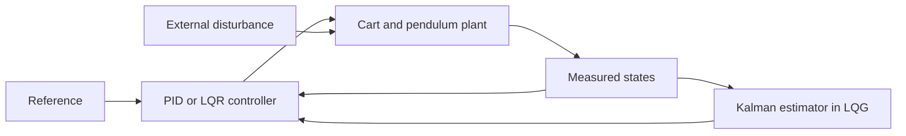

# Inverted Pendulum Control & Estimation

**A MATLAB/Simulink study of an unstable dynamical system, from physical modelling to feedback control and state estimation.**

University project at the Universitat Politècnica de Catalunya (UPC), developed for Optimization in the BSc in Artificial Intelligence by **Joel Alfaro and Pau Costa**, June 2026.

The project investigates how a motor-driven cart can keep a pendulum upright. It compares PID and Linear Quadratic Regulator (LQR) control, implements a Kalman state estimator, and combines estimation and control in an LQG configuration. Reference tracking and external disturbances extend the baseline stabilization problem.

## What the project demonstrates

- Physical modelling and linearization around an unstable equilibrium.
- Controllability, observability and stability analysis using a four-state model.
- Feedback design with PID, optimal quadratic control and pole placement.
- State estimation under process and measurement noise.
- Simulation-based comparison of stabilization, tracking and disturbance rejection.

The repository includes **seven Simulink models**, the MATLAB initialization script, a 3D world, a technical report and presentation slides. The report and slides preserve the original Spanish technical content.

## Control architecture



The direct feedback path represents the full-state LQR setup; the estimator path represents LQG. PID uses the cart and pendulum feedback loops configured in its model.

## Model and design

The state ordering is `[x, theta, x_dot, theta_dot]`: cart position, pendulum angle and their velocities. The report uses the upright equilibrium `theta = pi` radians; the linear state-space design operates around that equilibrium.

`Init_Setup_LQRArd.m` constructs the continuous-time matrices `A` and `B` from the cart, pendulum and motor constants, then calculates feedback and estimator gains.

| Quantity | Value in the initialization script |
|---|---:|
| Cart mass `M` | 0.136 kg |
| Pendulum mass `m` | 0.1 kg |
| Pendulum length parameter `l` | 0.2 m |
| Pendulum inertia `I` | 0.0007176 kg·m² |
| Motor resistance `Rm` | 12.5 Ω |
| Motor constants `kb`, `kt` | 0.031 |
| LQR state cost `Q` | `diag([1200, 1500, 0, 0])` |
| LQR input cost `R` | 0.035 |
| Full-state output matrix `C` | `eye(4)` |

The LQR objective balances state deviation and control effort through the continuous quadratic cost `integral(z'Qz + u'Ru) dt`. The initialization also calculates a pole-placement controller and a dual LQR solution for the estimator gain.

## Results and evidence

The [technical report](docs/technical-report.pdf) documents the original simulations and their figures:

| Experiment | Documented observation |
|---|---|
| PID stabilization | The controller stabilizes the inverted configuration, with behavior depending on tuning. |
| Full-state LQR | The ideal simulation gives a well-damped response and returns toward the upright equilibrium. |
| Kalman estimation and LQG | The estimator enables feedback with noise; the reported configuration shows cart offset or oscillation even when the angle stabilizes. |
| Reference tracking | A 0.1 m cart reference tests position control while balancing the pendulum. |
| Sinusoidal force disturbance | The reported LQR response recovers after the initial deviation. |

These are simulation observations from the submitted report, rather than hardware results or newly measured benchmarks. The repository does not claim a universal controller ranking or publish numerical settling-time guarantees.

An independent check of the initialization constants gives controllability rank **4**, full-state observability rank **4**, and an unstable open-loop pole near **+6.918**. The computed LQR gain is approximately:

```text
K = [-185.1640, 291.3571, -110.7681, 31.2682]
```

The resulting closed-loop poles are approximately `-36.6643 ± 33.3729i` and `-2.2773 ± 1.8378i`, consistent with asymptotic stability of the linear model. The [verification record](docs/linear-model-check.json) contains these calculations and the estimator poles. This check does **not** execute or validate the nonlinear Simulink models.

## Run the project

Use MATLAB with **Simulink** and **Control System Toolbox**. Models contain legacy Simulink 3D Animation blocks; viewing their animation also requires a compatible installation of that product. Saved model metadata includes MATLAB R2025b; compatibility with older releases has not been verified.

1. Extract or clone this repository and open its root folder in MATLAB.
2. Run the launcher:

   ```matlab
   run_project
   ```

3. The launcher loads the parameters and opens `LQR/IP_LQR_Design.slx`. Run the model from Simulink and inspect its scopes.
4. Open another model from the table below to inspect a different configuration. Initialize the workspace first and keep the working directory at the repository root.

The initialization begins with `clear all`, so save unrelated MATLAB workspace variables before running it.

| Path | Purpose |
|---|---|
| `Init_Setup_LQRArd.m` | Physical constants, state-space matrices and control/estimator gains |
| `Open-loop/OpenLoop.slx` | Uncontrolled baseline |
| `PID/PID.slx` | PID feedback configuration |
| `LQR/IP_LQR_Design.slx` | Full-state LQR controller |
| `KalmanFilter/Kalman_Filter.slx` | State estimation configuration |
| `LQG/LQG.slx` | Combined estimation and feedback |
| `EXTENSIONES/EXTENSION1.slx` | Reference-tracking extension |
| `EXTENSIONES/EXTENSION2.slx` | External-disturbance extension |
| `Inverted_pendulum12.wrl` | Original 3D scene |
| `docs/technical-report.pdf` | Technical derivation, experiments and discussion |
| `docs/presentation.pdf` | Project presentation |

## Reproducibility and limitations

The portfolio package replaces four machine-specific 3D world paths with relative references and provides a root-folder launcher. The original 3D world references `texture/Marble3.jpg`, which was absent from the supplied project archive; its appearance may therefore differ or produce a missing-texture warning. This asset is not recreated here.

The linear design assumes operation near the upright equilibrium. Noise assumptions, weights and reference handling materially affect LQG behavior. The original report identifies further tuning and improved tracking as development opportunities. No physical device or deployment is included.

MATLAB/Simulink simulations have not been rerun during portfolio preparation. The package was checked for archive integrity, portable world references and consistency of the linear-algebra calculations.

## Academic context and attribution

Team project by **Joel Alfaro and Pau Costa**, UPC, Optimization, June 2026. The original technical body and figures are retained; the report cover was replaced for portfolio presentation. The supplied models retain their original metadata, including an inherited Simulink template. Inclusion does not imply that every underlying template or asset was authored by the project team.

No additional redistribution license is granted by this README.
